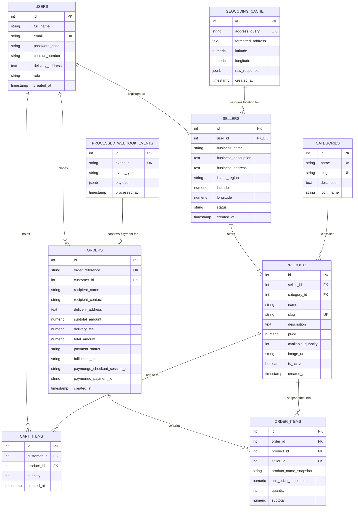

# IslandBox: Local Products and Souvenir Marketplace
## Comprehensive System Architecture & Master Implementation Plan (Academic Capstone - SIA Group 1)

---

### 1. Executive Summary & Source of Truth Alignment

- **Project Title:** IslandBox: Local Products and Souvenir Marketplace
- **Course & Context:** Systems Integration and Architecture (SIA) Course, Group 1 Academic Project
- **Primary Source of Truth:** `docs/proposal.pdf` (approved project proposal)
- **Standing Rules Version:** 1.0 (Strict Phase-Gate Execution)

#### 1.1 Problem Statement & Value Proposition
Local artisans, small food producers, and souvenir cottage industries across Philippine island communities (e.g., Bohol, Cebu, Visayas) face severe barriers to digital visibility. Visitors and cultural consumers struggle to find authentic local goods in one centralized, credible platform. IslandBox bridges this gap by offering a curated, authentic island marketplace emphasizing seller location transparency, local storytelling, direct ordering, and verified digital payment.

#### 1.2 Tier 1 (Mandatory Proposal Scope) vs. Tier 2 (Planned Extensible Scope)
To guarantee project success and adhere strictly to project governance:
- **Tier 1 (Mandatory - Current Active Scope):**
  1. User Registration & Secure Login (Full name, email, password, contact number, delivery address).
  2. Local Product Catalog (Categories: local snacks, handicrafts, souvenirs, accessories, handmade; product details: name, description, price in PHP, seller, location, available quantity, product image).
  3. Search & Category Filtering.
  4. Seller Location via Leaflet & Geoapify Geocoding API.
  5. Shopping Cart with pre-checkout order review.
  6. PayMongo Test Checkout (Hosted Checkout Session v2, supporting both successful and failed payment journeys).
  7. Order Tracking Statuses: `Pending` -> `Paid` -> `Preparing` -> `Shipped` -> `Completed`.
  8. End-to-End Demo Flow: Register -> Browse Local Products -> View Seller/Location -> Add to Cart -> Checkout -> Pay (PayMongo Test) -> Track Order.
- **Tier 2 (Post-Tier-1 Extras - Staged for Approval):**
  - Admin analytics dashboard, platform configuration, automated seller approval workflow, product moderation/reporting, seller earnings summary, and explicit `Canceled` status transition.

---

### 2. Architecture & Tech Stack Specifications

```
+--------------------------------------------------------------------------+
|                          CLIENT TIER (Browser)                           |
|  React 19 + Vite | Tailwind CSS v4 | React Router v7 | Leaflet 1.9.4      |
+--------------------------------------------------------------------------+
                                    |
                    HTTPS / REST API (JSON) + Cookies
                                    |
+--------------------------------------------------------------------------+
|                          APPLICATION BACKEND                             |
|  Node.js (v24 LTS) + Express.js                                          |
|                                                                          |
|  +-------------------+  +--------------------+  +---------------------+  |
|  | Security & Auth   |  | Payment Service    |  | Geocoding Service   |  |
|  | - bcrypt (12 rds) |  | - PayMongo v2 API  |  | - Geoapify REST     |  |
|  | - httpOnly Cookie |  | - Webhook HMAC-256 |  | - DB LRU Cache      |  |
|  | - RBAC Middleware |  | - Idempotency Lock |  | - Mock Fallback     |  |
|  +-------------------+  +--------------------+  +---------------------+  |
|                                                                          |
|  Controllers -> Service Layer -> Parameterized SQL Query Layer           |
+--------------------------------------------------------------------------+
                                    |
                       TCP Port 5432 (pg Pool)
                                    |
+--------------------------------------------------------------------------+
|                          DATABASE STORAGE                                |
|  PostgreSQL 18 (Local Service postgresql-x64-18)                         |
|  - Relational Schema with Constraints, Foreign Keys & Check Rules        |
|  - Exact Money Types: NUMERIC(12, 2) in Philippine Pesos (PHP)           |
|  - ACID Multi-row Transactions (Checkout, Stock Locks, Payment Sync)     |
+--------------------------------------------------------------------------+
```

#### 2.1 Technology Stack Matrix
| Component | Technology | Rationale & Academic Justification |
| :--- | :--- | :--- |
| **Frontend UI** | React 19 + Vite | Fast HMR development, clean component lifecycle, wide ecosystem support. |
| **Styling** | Tailwind CSS | Utility-first, responsive, lightweight UI without bulky third-party component suites. |
| **Client Routing**| React Router v7 | Declarative SPA routing with protected route guards for customer, seller, admin. |
| **Interactive Maps**| Leaflet 1.9.4 | Open-source, lightweight map renderer with OpenStreetMap tiles (free of Google Map billing constraints). |
| **Backend Runtime**| Node.js 24 + Express | Non-blocking I/O, mature middleware ecosystem, high performance for REST APIs. |
| **Database** | PostgreSQL 18.6 | Enterprise relational DBMS with ACID compliance, JSONB support, and strict type checking. |
| **DB Client** | `pg` (node-postgres) | Direct parameterized queries, transparent connection pooling, no ORM abstraction opacity. |
| **Authentication**| `httpOnly` Cookie + JWT | Mitigates XSS attack vectors, automated browser credential transport, stateless claim verification. |
| **Password Hashing**| `bcrypt` (12 salt rounds) | Industry standard, robust defense against rainbow tables and brute force. |
| **Payments** | PayMongo Hosted Checkout v2 | Philippine-native payment gateway supporting Cards, GCash, Maya, and QR Ph in sandbox mode. |
| **Geocoding** | Geoapify Geocoding API | 3,000 free requests/day, forward address resolution, cached in PostgreSQL. |

---

### 3. Database Schema & Data Dictionary

#### 3.1 Entity Relationship Diagram (ERD Overview)



#### 3.2 Data Integrity & Schema Rules
1. **Financial Precision:** All monetary amounts (`price`, `subtotal_amount`, `delivery_fee`, `total_amount`, `unit_price_snapshot`, `subtotal`) use `NUMERIC(12, 2)` denominated in Philippine Pesos (PHP). Never JavaScript floating point numbers.
2. **Immutable Order Snapshots:** When an order is placed, `product_name_snapshot` and `unit_price_snapshot` freeze the exact product data at checkout time. Future edits to product names or prices by sellers will never mutate historical order data.
3. **Explicit Foreign Key Deletions:**
   - `users` -> `sellers`: `ON DELETE CASCADE`
   - `sellers` -> `products`: `ON DELETE RESTRICT` (prevents deleting active sellers with product history)
   - `orders` -> `order_items`: `ON DELETE CASCADE`
   - `products` -> `order_items`: `ON DELETE RESTRICT` (prevents deleting products that have existing sales records)
   - `users` -> `orders`: `ON DELETE RESTRICT` (prevents deleting users with active financial transactions)
4. **Separation of Concerns:**
   - `payment_status`: Tracks monetary settlement (`unpaid`, `pending`, `paid`, `failed`, `refunded`).
   - `fulfillment_status`: Tracks product handling & logistics (`pending`, `paid`, `preparing`, `shipped`, `completed`, `canceled`).
5. **State Transition Rules (Backend-Enforced):**
   - An order CANNOT transition to `preparing`, `shipped`, or `completed` unless `payment_status = 'paid'`.
   - Seller can update fulfillment status ONLY for orders containing items from their inventory.
   - Customers can only inspect their own orders.

---

### 4. External API Integration Specifications

#### 4.1 PayMongo Hosted Checkout v2 Integration
- **Official Documentation:** [PayMongo Hosted Checkout Session API v2 Reference](https://developers.paymongo.com/reference/create-a-checkout-session)
- **Base Endpoint:** `POST https://api.paymongo.com/v2/checkout_sessions`
- **Authentication:** HTTP Basic Auth with base64 encoded Secret Key `sk_test_...:` in the `Authorization` header.
- **Payload Schema:**
  ```json
  {
    "data": {
      "attributes": {
        "line_items": [
          {
            "name": "Bohol Artisanal Calamay",
            "amount": 18000,
            "currency": "PHP",
            "quantity": 2
          }
        ],
        "payment_method_types": ["card", "gcash", "paymaya", "qrph"],
        "success_url": "http://localhost:5173/orders/success?session_id={CHECKOUT_SESSION_ID}&ref=IB-20261029-XXXX",
        "cancel_url": "http://localhost:5173/orders/cancel?ref=IB-20261029-XXXX",
        "reference_number": "IB-20261029-XXXX",
        "description": "IslandBox Order IB-20261029-XXXX"
      }
    }
  }
  ```
  *(Note: PayMongo expects amounts in the smallest currency unit: centavos. ₱180.00 = 18000).*

- **Webhook Verification & Idempotency:**
  - **Webhook URL:** `POST /api/webhooks/paymongo`
  - **Signature Header:** `Paymongo-Signature: t=<timestamp>,te=<test_hmac>,li=<live_hmac>`
  - **Verification Computation:** `crypto.createHmac('sha256', webhookSecret).update(`${t}.${rawBody}`).digest('hex')`
  - **Comparison:** `crypto.timingSafeEqual(Buffer.from(computed), Buffer.from(te))`
  - **Idempotent Handling:** Check `processed_webhook_events` table for `event_id`. If already present, respond `200 OK` immediately without duplicate updates.
  - **Security Rule:** A frontend redirection to `success_url` is NEVER treated as final proof of payment. Payment is confirmed only upon verified server-side webhook notification or direct server-to-server query against the PayMongo Checkout Session endpoint (`GET /v2/checkout_sessions/:id`).
  - **Free/Test Tier:** 100% Free in Sandbox/Test Mode. Test card credentials and GCash mock flows are officially supported.

#### 4.2 Geoapify Geocoding API Integration
- **Official Documentation:** [Geoapify Geocoding API Documentation](https://apidocs.geoapify.com/docs/geocoding/geocoding-api/)
- **Base Endpoint:** `GET https://api.geoapify.com/v1/geocode/search`
- **Query Parameters:** `text=<AddressString>&apiKey=<GEOAPIFY_API_KEY>&limit=1`
- **Free Tier Quota:** 3,000 requests per day (1 request = 1 credit).
- **Service Layer Architecture (`services/geocodingService.js`):**
  - Check local PostgreSQL `geocoding_cache` first.
  - If cached, return coordinates immediately (0 API credits used).
  - If cache miss and API key is configured, invoke Geoapify, store coordinates in `geocoding_cache`, and return.
  - Fallback / Mock Mode: If no API key is provided or quota is exhausted, fall back gracefully to pre-seeded Bohol/Visayas landmark coordinates with a console notification, ensuring zero disruption to academic grading.
- **Attribution Requirement:** "Powered by Geoapify | © OpenStreetMap contributors".

#### 4.3 Leaflet Map Integration
- **Library:** Leaflet 1.9.4
- **Tile Provider:** OpenStreetMap standard tile server `https://{s}.tile.openstreetmap.org/{z}/{x}/{y}.png`
- **Mandatory Attribution:** `&copy; <a href="https://www.openstreetmap.org/copyright">OpenStreetMap</a> contributors`
- **Privacy & Security Boundaries:**
  - Seller map displays the seller's verified **business address** and island town/barangay coordinates only.
  - Private residential homes of customers and live GPS delivery traces are strictly prohibited on the map.
  - The map is clearly labeled as "Seller Business Location", avoiding false implications of real-time courier tracking.

---

### 5. Security & Access Control Architecture

1. **Role-Based Access Control (RBAC):**
   - `customer`: Can view products/sellers, manage own cart, create orders, view own order tracking and profile.
   - `seller`: All customer capabilities + manage own shop profile, create/update/archive own products, view orders containing own items, advance order fulfillment status (`preparing`, `shipped`). Cannot modify other sellers' products or view unrelated orders.
   - `admin`: Platform supervision, manage product categories, inspect all transactions.
2. **Input Validation & Sanitization:**
   - Server-side validation using `express-validator` on every endpoint.
   - Price, quantity, and stock totals are calculated and validated exclusively on the backend. The client total is never trusted.
3. **Defense Against Common Web Vulnerabilities:**
   - **SQL Injection:** 100% parameterized queries via `$1, $2, ...` placeholders in `pg`. ORM or raw string concatenations are strictly banned.
   - **XSS:** Content security headers via `helmet`, sanitized user strings, and authentication token stored in `httpOnly, SameSite=lax` cookie inaccessible to client JavaScript.
   - **CSRF:** SameSite cookies and custom header validation on mutating HTTP methods.
   - **Brute Force & DoS:** `express-rate-limit` on `/api/auth/login`, `/api/auth/register`, and `/api/checkout`.
   - **Sensitive Data Handling:** Passwords hashed with `bcrypt` (12 rounds). Zero card data stored. Server logs sanitized to strip passwords, Authorization headers, and webhook payloads.

---

### 6. Realistic Philippine-Themed Seed Data Specification

The dataset will center on **Bohol & Central Visayas** island producers:
- **Seller 1:** *Alona Shell & Artisan Crafts* (Panglao, Bohol) - Coordinates: 9.5772, 123.7711
- **Seller 2:** *Antequera Loomweavers Cooperative* (Antequera, Bohol) - Coordinates: 9.7797, 123.9008
- **Seller 3:** *Jagna Calamay & Delicacies Heritage* (Jagna, Bohol) - Coordinates: 9.6528, 124.3686
- **Seller 4:** *Chocolate Hills Keepsakes & Tarsier Woodcraft* (Carmen, Bohol) - Coordinates: 9.8297, 124.1972
- **Seller 5:** *Tubigon Raffia & Fiber Arts* (Tubigon, Bohol) - Coordinates: 9.9519, 123.9622

**Featured Categories & Items:**
1. **Local Snacks:** Original Jagna Calamay in Coconut Shell (₱180.00), Boholano Peanut Kisses 3-Pack (₱150.00), Asin Tibook Heritage Sea Salt (₱580.00).
2. **Handicrafts:** Handwoven Antequera Raffia Basket (₱450.00), Artisanal Bamboo Windchime (₱280.00).
3. **Souvenirs:** Hand-carved Wooden Tarsier Figurine (₱220.00), Bohol Island Resin Magnet (₱95.00).
4. **Accessories:** Mother of Pearl Pendant Necklace (₱350.00), Hand-braided Abaca Bracelet (₱120.00).
5. **Handmade Products:** Virgin Coconut Oil Cold-Pressed Soap (₱85.00), Island Lemongrass Soothing Balm (₱140.00).

---

### 7. Phased Implementation Roadmap

```
+--------------------------------------------------------------------------+
| Phase 1: Analyze & Plan (CURRENT PHASE)                                  |
| - Requirements reconciliation with docs/proposal.pdf                     |
| - Full system architecture, database schema, & API specifications        |
| - Key decision justifications (Auth, Workspaces, State Machines)         |
+--------------------------------------------------------------------------+
                                    | [STOP & AWAIT USER APPROVAL]
+--------------------------------------------------------------------------+
| Phase 2: Project Foundation & Database Infrastructure                    |
| - Initialize monorepo structure (backend/ and frontend/)                 |
| - PostgreSQL database setup, migration runner, schema DDL, seed data     |
| - Express boilerplate with error handling, logging, and health endpoint  |
+--------------------------------------------------------------------------+
                                    | [STOP & AWAIT USER APPROVAL]
+--------------------------------------------------------------------------+
| Phase 3: Authentication & Role Authorization                             |
| - Registration & login with validation (customer & seller roles)         |
| - httpOnly cookie session issuance and verification middleware           |
| - React Auth Context, protected route guards, and UI login/register forms|
+--------------------------------------------------------------------------+
                                    | [STOP & AWAIT USER APPROVAL]
+--------------------------------------------------------------------------+
| Phase 4: Product Catalog & Seller Management                             |
| - Product browsing, search, and category filtering                       |
| - Product detail view with seller info, price, stock, and images         |
| - Seller product creation/editing portal with ownership verification     |
+--------------------------------------------------------------------------+
                                    | [STOP & AWAIT USER APPROVAL]
+--------------------------------------------------------------------------+
| Phase 5: Maps & Geocoding Integration (Geoapify + Leaflet)               |
| - Backend geocoding service with PostgreSQL caching layer                |
| - Leaflet interactive map component with OpenStreetMap tiles & attribution|
| - Display seller business locations on product and shop profile pages    |
+--------------------------------------------------------------------------+
                                    | [STOP & AWAIT USER APPROVAL]
+--------------------------------------------------------------------------+
| Phase 6: Shopping Cart & Order Checkout System                           |
| - Persistent customer shopping cart (add, update qty, remove)            |
| - Pre-checkout order review with server-side price/stock verification    |
| - Order creation in transaction with stock reservation                   |
+--------------------------------------------------------------------------+
                                    | [STOP & AWAIT USER APPROVAL]
+--------------------------------------------------------------------------+
| Phase 7: PayMongo Test Checkout Integration                              |
| - PayMongo Hosted Checkout Session v2 creation                           |
| - Webhook endpoint with HMAC-SHA256 signature verification & idempotency |
| - Handle successful payments, failed payments, and cancel return flows   |
+--------------------------------------------------------------------------+
                                    | [STOP & AWAIT USER APPROVAL]
+--------------------------------------------------------------------------+
| Phase 8: Order Tracking & Role-Based Dashboards                          |
| - Customer order tracking page: Pending -> Paid -> Preparing -> Shipped  |
| - Seller order management dashboard with transition permissions          |
| - Minimal admin view for category & user oversight (Tier 2 baseline)    |
+--------------------------------------------------------------------------+
                                    | [STOP & AWAIT USER APPROVAL]
+--------------------------------------------------------------------------+
| Phase 9: Testing, Quality Assurance & Security Audit                     |
| - Integration test suite (Auth, Stock concurrency, Webhook verification)  |
| - Cross-browser & responsive mobile testing                              |
| - Edge cases: stock exhaustion, invalid cards, malicious payloads        |
+--------------------------------------------------------------------------+
                                    | [STOP & AWAIT USER APPROVAL]
+--------------------------------------------------------------------------+
| Phase 10: Academic Documentation & Capstone Demonstration Pack           |
| - README.md with complete setup and demo script                          |
| - Seed credentials list and PayMongo test cards/GCash instructions       |
| - Final architectural walkthrough for SIA presentation defense           |
+--------------------------------------------------------------------------+
```

---

### 8. Key Architectural Decisions Submitted for User Confirmation

1. **Auth Strategy Recommendation: `httpOnly` Cookie with Signed JWT**
   - *Alternative:* Storing tokens in `localStorage`.
   - *Academic Recommendation:* `httpOnly` cookie. It prevents XSS attackers from stealing tokens via script injection, eliminates manual token interceptor boilerplate in Axios/Fetch, and provides clean session invalidation on logout.
2. **Workspace Recommendation:**
   - Designate `C:\Users\User\.gemini\antigravity\scratch\islandbox` as the active project workspace root so that all future code, migrations, and dependencies reside in a clean, self-contained project tree.
3. **Database Selection:**
   - Leverage the local, running PostgreSQL 18 instance (`postgresql-x64-18`) on `localhost:5432` with a dedicated database `islandbox_db`.

